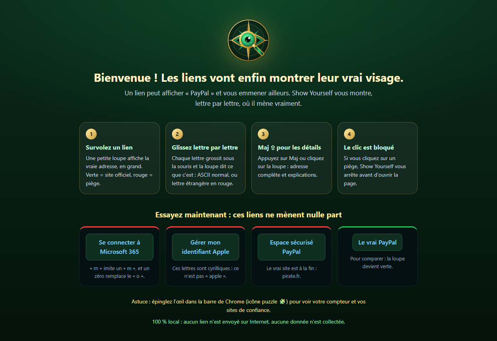
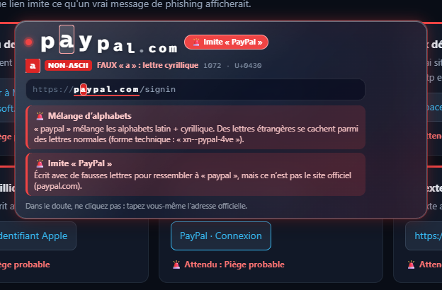
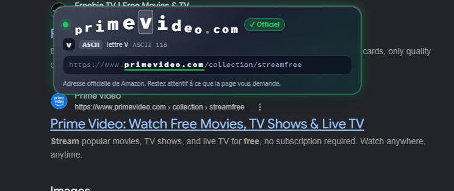
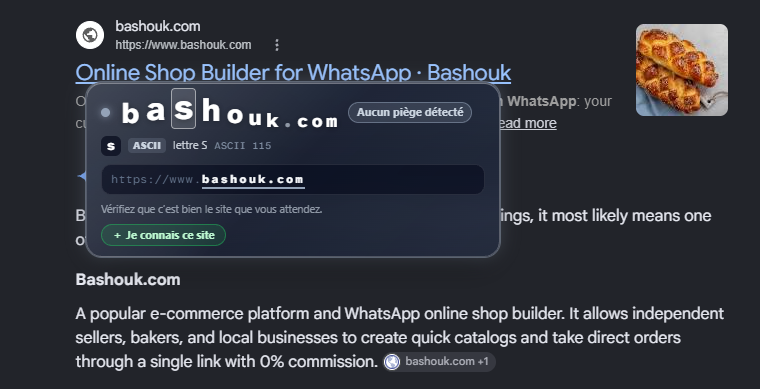
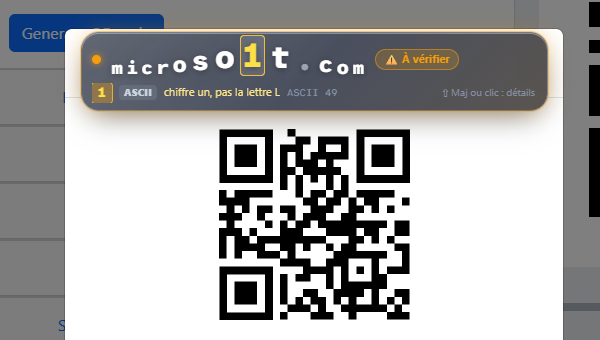
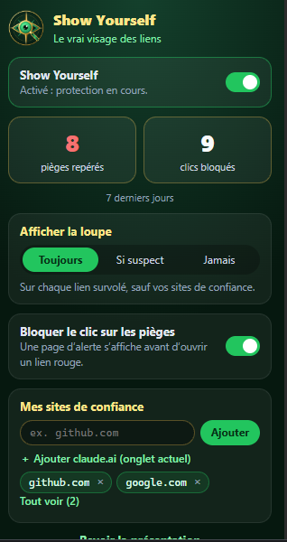
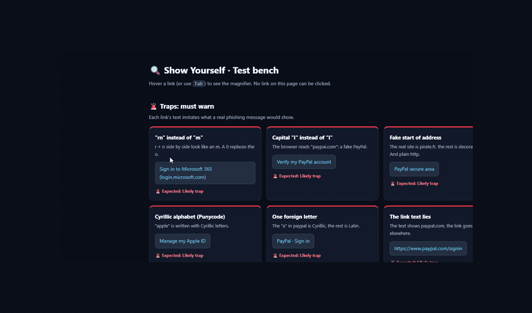

# Show Yourself

🇬🇧 [English](README.md) · 🇫🇷 Français

**Voyez qui se cache vraiment derrière un lien, un expéditeur ou un fichier, avant de cliquer.**

Les arnaques ne piratent pas votre ordinateur. Elles piratent ce que vous voyez. Show Yourself
est une extension Chrome qui révèle les faits, 100 % en local, sans juger les sites.

## Ce qu'elle fait

- **Liens** : survolez un lien pour voir sa vraie destination, lettre par lettre. Les lettres
  d'autres alphabets qui imitent les nôtres et les redirections cachées sont révélées.
- **Expéditeurs** : survolez le nom d'un expéditeur dans votre webmail pour voir l'adresse
  complète derrière.
- **Fichiers déguisés** : les noms comme `facture.pdf.exe` ou inversés par des caractères
  invisibles sont démasqués ; les téléchargements suspects sont mis en pause jusqu'à votre décision.
- **QR codes** : clic droit sur une image pour révéler le lien caché dans un QR code.

## En action

### Piège repéré

`pаypal.com` a l'air vrai, mais son « а » est une lettre cyrillique. La loupe l'affiche en
rouge, explique la ruse et vous dit de ne pas cliquer.

### Site officiel

La vraie adresse, lettre par lettre, avec un badge vert « Officiel » pour les grandes marques.

### Site inconnu

Aucun piège trouvé : l'extension montre les faits et vous laisse décider. Un clic l'ajoute à
vos sites de confiance.

### Faux site caché dans un QR code

`microso1t.com` : le « 1 » est un chiffre, pas la lettre L. Clic droit sur une image de QR
code pour révéler son lien.

### La fenêtre des réglages

- Activer ou couper la protection.
- Voir combien de pièges ont été repérés et de clics bloqués sur 7 jours.
- Choisir quand la loupe s'affiche : toujours, si suspect, ou jamais.
- Bloquer le clic sur les liens dangereux avec une page d'alerte.
- Gérer vos sites de confiance : ils n'affichent jamais la loupe.

L'interface est en français ou en anglais, selon la langue de Chrome.

 

## Démo

## Confidentialité

Tout se passe sur votre ordinateur : pas de compte, pas de serveur, aucun pistage.
Voir [PRIVACY.md](PRIVACY.md) ou https://showyourself.app/privacy/

## Installation

- Depuis le Chrome Web Store (lien bientôt disponible).
- Depuis le code source : ouvrez `chrome://extensions`, activez le **Mode développeur**,
  cliquez sur **Charger l'extension non empaquetée** et choisissez ce dossier.

## Licence

© 2026 Bashouk Labs. **Tous droits réservés** ([LICENSE](LICENSE)).

Le code est public pour que chacun puisse vérifier ce que fait l'extension : rien ne quitte
votre ordinateur. Vous pouvez le lire, utiliser l'extension et signaler des problèmes, mais
le copier, le modifier ou le republier est interdit sans autorisation écrite. jsQR
(Apache 2.0) et Atkinson Hyperlegible Mono (OFL 1.1) gardent leurs propres licences.

Contact : contact@bashouk.com
