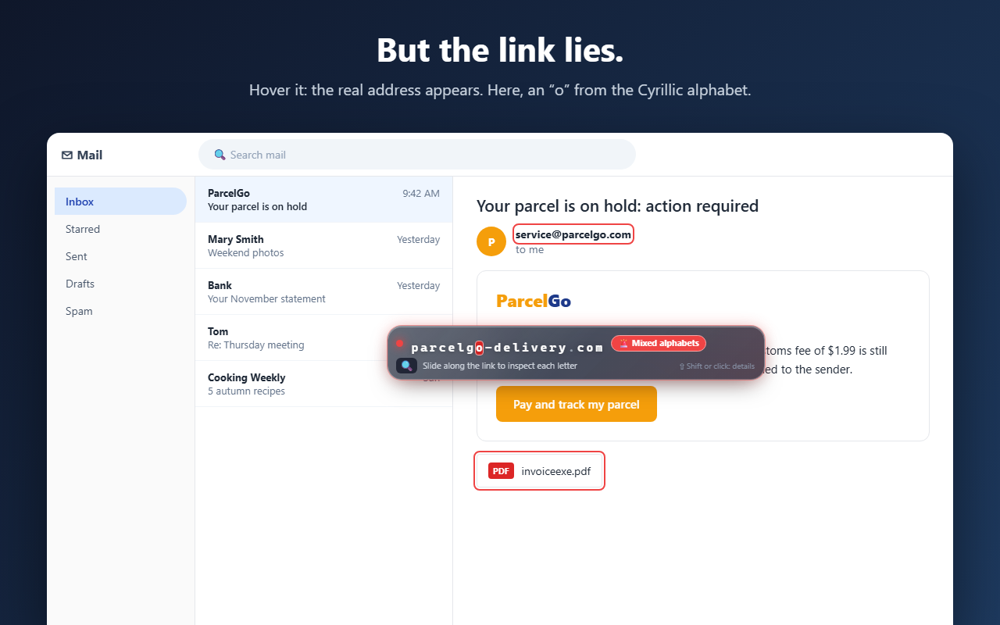
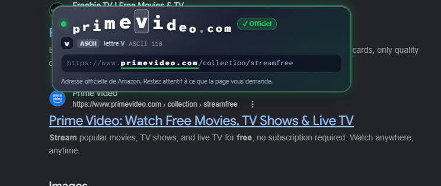
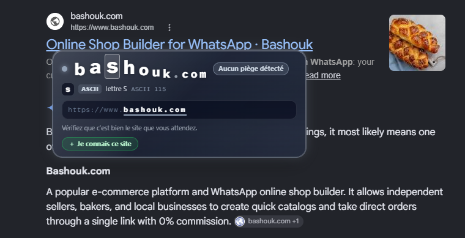
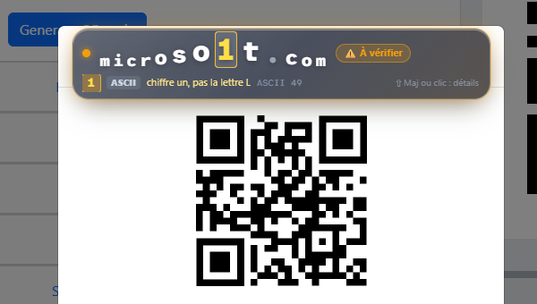
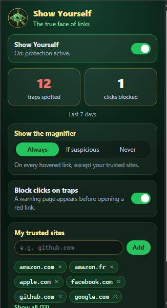

# Show Yourself

**See who's really behind a link, a sender or a file, before you click.**

Scams don't hack your computer. They hack what you see. Show Yourself is a Chrome
extension that reveals the facts, 100% locally, without judging websites.



## What it does

- **Links**: hover any link to see its real destination, letter by letter. Look-alike
  letters from other alphabets and hidden redirects are revealed.
- **Senders**: hover a sender's name in your webmail to see the full address behind it.
- **Disguised files**: names like `invoice.pdf.exe` or names flipped by invisible
  characters are unmasked; suspicious downloads are paused until you decide.
- **QR codes**: right-click an image to reveal the link hidden in a QR code.

## See it in action

### Official site

The real address, letter by letter, with a green "Official" badge for well-known brands.



### Unknown site

No trap found: the extension shows the facts and lets you decide. One click adds it to your trusted sites.



### Look-alike caught in a QR code

`microso1t.com`: the "1" is a digit, not the letter L. Right-click any QR image to reveal its link.





### The popup

- Turn protection on or off.
- See how many traps were spotted and clicks blocked in the last 7 days.
- Choose when the magnifier appears: always, only when suspicious, or never.
- Block clicks on dangerous links with a warning page.
- Manage your trusted sites: they never show the magnifier.

The interface is in French or English, following Chrome's language.

<br clear="right">

## Privacy

Everything runs on your computer: no account, no server, no tracking.
See [PRIVACY.md](PRIVACY.md) or https://showyourself.app/privacy/

## Install

- From the Chrome Web Store (link coming soon).
- From source: open `chrome://extensions`, turn on **Developer mode**, click
  **Load unpacked** and select this folder.

## Development

No build step, no dependencies: plain JavaScript (Manifest V3).

```
node tests/analyzer.test.js     # analyzer unit tests
node tests/background.test.js   # background unit tests
```

Open `test.html` in Chrome with the extension loaded to try every case by hand.

| File | Role |
|---|---|
| `analyzer.js` | Link, sender and file-name analysis (pure, tested) |
| `files.js` | Disguised file-name detection |
| `content.js` | Hover bubble, outlines, click blocker |
| `background.js` | QR decoding, download guard, install flow |
| `i18n.js`, `_locales/` | French / English |
| `features.js` | Feature flags |

## License

© 2026 Bashouk Labs. **All rights reserved** ([LICENSE](LICENSE)).

The code is public so you can check exactly what the extension does: nothing
leaves your computer. You are welcome to read it, use the extension and report
issues, but copying, modifying or republishing it is not allowed without
written permission. jsQR (Apache 2.0) and Atkinson Hyperlegible Mono (OFL 1.1)
keep their own licenses.

Contact: contact@bashouk.com
